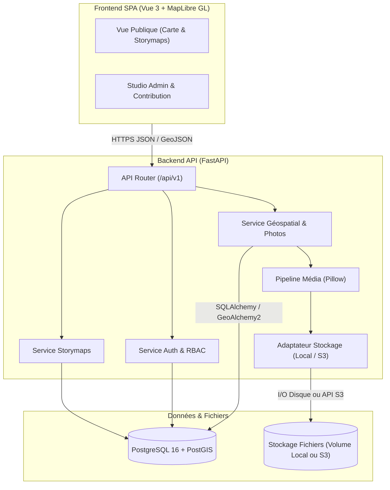
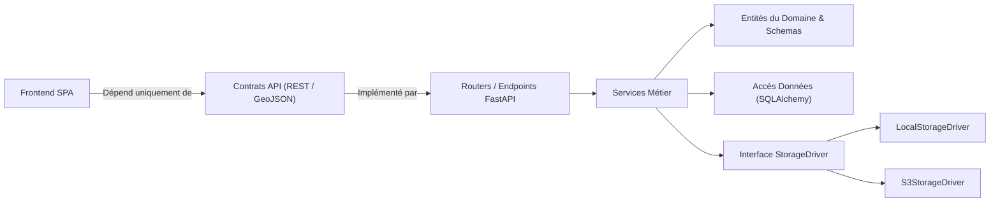
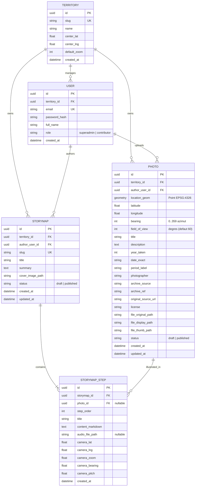

# Architecture Spine — HierIci

## Design Paradigm

HierIci adopte le paradigme **API-First Découplé avec Persistance Spatiale**. 

Le système est partitionné en deux briques indépendantes reliées par un contrat d'API REST/GeoJSON strict :
1. **Frontend Client (SPA)** : Application web réactive (Vue 3 / TypeScript + Vite) hébergeant le visualiseur cartographique (MapLibre GL JS) et le studio d'administration. Zéro logique métier critique côté client.
2. **Backend API (FastAPI / Python 3.12)** : Monolithe modulaire stateless gérant l'authentification (JWT), l'accès aux données géospatiales (SQLAlchemy + GeoAlchemy2), la validation (Pydantic), le pipeline de traitement d'images (Pillow) et l'accès au stockage abstrait.
3. **Persistance Spatiale (PostgreSQL 16 + PostGIS)** : Base relationnelle unique assurant l'intégrité référentielle, le partitionnement logique par territoire et l'indexation spatiale (GiST).



---

## Invariants & Rules

### Diagramme de direction des dépendances



---

### AD-1 — Représentation spatiale standardisée et calcul des cônes de vue
- **Binds:** FR-1, FR-2, FR-8, NFR-1
- **Prevents:** Divergence entre le stockage géométrique en base, les formats de sortie GeoJSON et le tracé vectoriel dans MapLibre GL JS.
- **Rule:** 
  1. Toutes les coordonnées géographiques sont stockées dans le système de coordonnées de référence **WGS84 (EPSG:4326)** sous forme de géométrie `Point(longitude, latitude)`.
  2. L'azimut (`bearing`) est stocké sous forme d'entier `0 <= bearing <= 359` (0° = Nord, 90° = Est).
  3. L'ouverture angulaire (`field_of_view`) est un entier (défaut : 60°).
  4. L'API expose les photos sous format standard **GeoJSON `FeatureCollection`**, où chaque `Feature` contient le point dans `geometry`, et l'azimut, la distance focale et les métadonnées dans `properties`.
  5. Le calcul géométrique du polygone du cône de vue (triangle/secteur angulaire projeté) est calculé côté client par MapLibre GL JS à l'aide de turf.js ou d'une fonction trigonométrique vectorielle légère, évitant ainsi de surcharger la base de données de géométries polygonales dérivées.

### AD-2 — Isolation logique stricte par Territoire (Multi-Tenancy)
- **Binds:** FR-14, UJ-1, UJ-2
- **Prevents:** Fuite de données entre territoires et refonte complexe lors du passage au multi-domaine.
- **Rule:**
  1. Toutes les tables de ressources (`photos`, `storymaps`, `users`) possèdent une clé étrangère obligatoire `territory_id`.
  2. Le backend résout le territoire actif au niveau du middleware HTTP selon la priorité suivante :
     - En-tête HTTP explicite `X-Territory-Slug`.
     - Sous-domaine de la requête (`{slug}.hierici.fr`).
     - Variable d'environnement par défaut `DEFAULT_TERRITORY_SLUG` (en V1).
  3. Toute requête publique vers la base de données applique impérativement un filtre `WHERE territory_id = :active_territory_id`.

### AD-3 — Pattern Adaptateur de Stockage Média (Storage Driver)
- **Binds:** FR-7, FR-13, NFR-2
- **Prevents:** Couplage du code métier à un système de fichiers local ou à un SDK cloud propriétaire.
- **Rule:**
  1. Les services applicatifs interagissent avec les fichiers multimédias exclusivement via l'interface abstraite `StorageDriver` définissant les méthodes asynchrones : `save(file, path) -> str`, `delete(path) -> bool`, `get_url(path) -> str`.
  2. Deux implémentations conformes sont fournies :
     - `LocalStorageDriver` : enregistre dans un répertoire monté (`/app/uploads`), accessible via serveur de fichiers statiques en développement.
     - `S3StorageDriver` : s'appuie sur `aioboto3` / `boto3` pour envoyer vers tout bucket compatible S3 (MinIO, Cloudflare R2, AWS, Scaleway).
  3. L'implémentation active est instanciée au démarrage selon la variable `STORAGE_DRIVER` (`local` ou `s3`).

### AD-4 — Pipeline d'ingestion et optimisation des photos d'archives
- **Binds:** FR-7, NFR-1, NFR-2
- **Prevents:** Saturation de la bande passante et temps de chargement excessifs liés aux fichiers d'archives haute définition (jusqu'à 25 Mo).
- **Rule:**
  1. À chaque téléversement d'image, le backend génère 3 déclinaisons :
     - `original` : fichier source intact (conservation archivistique).
     - `display` : image convertie en format WebP (qualité 85, résolution max redimensionnée à 2048px de large/haut), utilisée pour la fiche détaillée et la storymap.
     - `thumb` : vignette WebP (résolution max 400px de large/haut), utilisée pour la liste d'administration et les aperçus rapides.
  2. Le traitement s'exécute avec la bibliothèque **Pillow** avec désinfection des métadonnées EXIF potentiellement malveillantes.

### AD-5 — Cloisonnement et sécurité des accès (Statut & RBAC)
- **Binds:** FR-11, FR-12, NFR-2
- **Prevents:** Exposition publique de photos ou récits non validés, élévation de privilèges.
- **Rule:**
  1. Les routes publiques d'exploration (`/api/v1/photos`, `/api/v1/storymaps`) renvoient **uniquement** les enregistrements avec `status = 'published'`.
  2. Les routes de contribution et d'administration (`/api/v1/admin/*`) requièrent un token JWT signé avec l'algorithme `HS256` ou `RS256` et vérifient les permissions du rôle de l'utilisateur (`superadmin`, `contributor`).

---

## Consistency Conventions

| Domaine | Convention | Règle d'application |
| :--- | :--- | :--- |
| **Nommage BDD** | `snake_case`, tables au pluriel | `territories`, `photos`, `storymaps`, `storymap_steps`, `users` |
| **Nommage API** | `camelCase` pour JSON, URLs REST plurielles | `/api/v1/photos`, `/api/v1/storymaps`, champs JSON en `camelCase` (ex: `fieldOfView`, `createdAt`) |
| **Identifiants** | UUIDv7 ou CUID2 (triables chronologiquement) | Clés primaires `id` générées côté backend pour éviter les collisions |
| **Dates & Heures** | ISO 8601 UTC | `2026-10-31T09:45:00Z` pour les horodatages système |
| **Dates Historiques** | Schéma souple | `year: integer (nullable)`, `date_exact: string (nullable)`, `period_label: string (nullable)` |
| **Coordonnées** | Standard GeoJSON [longitude, latitude] | Attention à l'inversion classique : GeoJSON requiert `[lng, lat]` |
| **Gestion d'erreurs** | Enveloppe RFC 7807 (Problem Details) | `{"error": {"code": "RESOURCE_NOT_FOUND", "message": "Photo non trouvée", "details": {}}}` |

---

## Stack (Seed Pinned)

| Couche / Rôle | Technologie | Version | Rôle & Justification |
| :--- | :--- | :--- | :--- |
| **Runtime Backend** | Python | 3.12+ | Performance accrue, typage statique moderne, support async natif |
| **Framework API** | FastAPI | 0.115+ | Framework ASGI rapide, validation Pydantic v2, Swagger auto |
| **Base de Données** | PostgreSQL | 16-alpine | SGBD relationnel robuste et standard de l'industrie |
| **Extension Spatiale** | PostGIS | 3.4+ | Indexation spatiale GiST, types géométriques natifs |
| **ORM / Accès DB** | SQLAlchemy + GeoAlchemy2 | 2.0+ | Mapping objet-relationnel async, support des types géométriques |
| **Traitement Média** | Pillow | 10.x | Manipulation d'images, redimensionnement et compression WebP |
| **Moteur Cartographique** | MapLibre GL JS | 4.x | Rendu vectoriel WebGL fluide (60fps), animations `flyTo`, cônes d'azimut |
| **Framework Frontend** | Vue 3 + Vite | 3.4+ | Composition API, rapidité de build, intégration fluide avec MapLibre |
| **Styling UI** | TailwindCSS | 3.4+ | Design réactif, thémage moderne et composabilité des interfaces |
| **Conteneurisation** | Docker & Compose | 26+ / v2 | Déploiement reproductible en une commande |

---

## Structural Seed

### 1. Modèle Entité-Association (ERD)



---

### 2. Arborescence du Dépôt (Project Tree)

```text
hierici/
├── docker-compose.yml           # Orchestration locale (api, web, postgres+postgis)
├── Dockerfile.backend           # Image FastAPI Python 3.12
├── Dockerfile.frontend          # Image Nginx servant le build Vue 3
├── .env.example                 # Variables d'environnement documentées
├── backend/
│   ├── pyproject.toml           # Dépendances Python (uv / pip)
│   ├── app/
│   │   ├── main.py              # Point d'entrée FastAPI
│   │   ├── config.py            # Paramètres Pydantic Settings
│   │   ├── core/                # Sécurité, JWT, base de données, middlewares
│   │   │   ├── database.py      # Session async SQLAlchemy
│   │   │   ├── security.py      # Hachage mots de passe & tokens JWT
│   │   │   └── territory.py     # Middleware de résolution du territoire
│   │   ├── models/              # Modèles SQLAlchemy (Territory, Photo, Storymap, User)
│   │   ├── schemas/             # Schémas Pydantic (validation entrées/sorties)
│   │   ├── api/                 # Endpoints REST
│   │   │   ├── v1/
│   │   │   │   ├── public/      # Routes ouvertes (carte, photos GeoJSON, storymaps)
│   │   │   │   ├── admin/       # Routes protégées (upload, édition, gestion comptes)
│   │   │   │   └── auth.py      # Login, refresh token
│   │   └── services/            # Logique métier
│   │       ├── image_service.py # Redimensionnement, compression WebP (Pillow)
│   │       └── storage/         # Pattern adaptateur de stockage
│   │           ├── base.py      # Interface abstraite StorageDriver
│   │           ├── local.py     # LocalStorageDriver
│   │           └── s3.py        # S3StorageDriver
│   └── migrations/              # Scripts Alembic pour PostGIS
└── frontend/
    ├── package.json
    ├── vite.config.ts
    ├── src/
    │   ├── main.ts
    │   ├── assets/              # Styles Tailwind, icônes
    │   ├── components/
    │   │   ├── map/             # Composant MapLibre GL JS, cônes d'azimut, clusters
    │   │   ├── photo/           # Fiche détaillée, visualiseur HD, boussole d'orientation
    │   │   ├── storymap/        # Lecteur Scrollytelling, synchronisation caméra, audio
    │   │   └── admin/           # Formulaires de dépôt, gestion de liste
    │   ├── views/               # Pages principales (Carte publique, Récits, Admin)
    │   ├── stores/              # Pinia stores (territoire actif, filtres, session admin)
    │   └── services/            # Client API HTTP (Axios / Fetch typé)
```

---

## Capability → Architecture Map

| Capacité / Exigence PRD | Composant d'implémentation | Règle / Invariant d'architecture |
| :--- | :--- | :--- |
| **FR-1 : Carte & Clustering** | `frontend/components/map/` | AD-1 (MapLibre GL JS, tuiles vectorielles libres, clustering natif WebGL) |
| **FR-2 : Marqueur orienté & Cône** | `frontend/components/map/ViewCone.ts` | AD-1 (Génération vectorielle client du cône d'azimut selon `bearing` et `fov`) |
| **FR-3 : Fiche détaillée photo** | `frontend/components/photo/PhotoDetail.vue` | AD-1 (Consommation de l'image `display` WebP et lien original) |
| **FR-4 & FR-5 : Scrollytelling & Audio** | `frontend/components/storymap/StorymapReader.vue` | Synchronisation des événements scroll avec `map.flyTo()`, lecteur audio HTML5 |
| **FR-6 : Catalogue Storymaps** | `frontend/views/StorymapsView.vue` | Requête `/api/v1/public/storymaps` filtrée par territoire |
| **FR-7 : Upload & Optimisation** | `backend/services/image_service.py` | AD-4 (Génération automatique des 3 déclinaisons WebP via Pillow) |
| **FR-8 : Outil d'azimut interactif** | `frontend/components/admin/AzimuthPicker.vue` | AD-1 (Curseur rotatif boussole synchronisé avec la carte) |
| **FR-9 : Métadonnées d'archives** | `backend/schemas/photo.py` & `models/photo.py` | Schéma relationnel `PHOTO` avec support des formats de date souples |
| **FR-10 : Studio Storymap** | `frontend/views/admin/StorymapEditor.vue` | Modèle relationnel `STORYMAP_STEP` ordonné |
| **FR-11 & FR-12 : RBAC & Auth** | `backend/core/security.py` & `api/v1/admin/` | AD-5 (Tokens JWT, hachage Argon2/bcrypt, rôles `superadmin`/`contributor`) |
| **FR-13 : Adaptateur Stockage** | `backend/services/storage/` | AD-3 (Interface abstraite `StorageDriver` avec `LocalStorageDriver` et `S3StorageDriver`) |
| **FR-14 : Multi-Territoire** | `backend/core/territory.py` | AD-2 (Middleware d'isolation par `territory_id`) |

---

## Deferred (Décisions reportées)

1. **Génération de tuiles vectorielles dynamiques côté serveur (MVT / Martin / pg_tileserv)** :
   * *Raison du report* : Pour un corpus initial de 100 à 5 000 photographies par territoire, l'envoi d'un flux GeoJSON compressé (`gzip`/`brotli`) depuis l'API FastAPI est ultra-rapide (< 100 ms) et consomme infiniment moins de ressources qu'un serveur de tuiles vectorielles dédié. Le passage à un serveur MVT sera envisagé en V3 si le volume dépasse 50 000 points.
2. **Authentification OAuth2 / Réseaux sociaux ou FranceConnect** :
   * *Raison du report* : Le nombre de contributeurs initiaux est restreint ; l'authentification native email/mot de passe sécurisée est suffisante pour le lancement.
3. **Automatisation DNS wildcard / provisioning de certificat SSL à la volée** :
   * *Raison du report* : La V1 utilise une instance simple configurée via `DEFAULT_TERRITORY_SLUG`. Les sous-domaines seront configurés manuellement via reverse proxy dans un premier temps.
