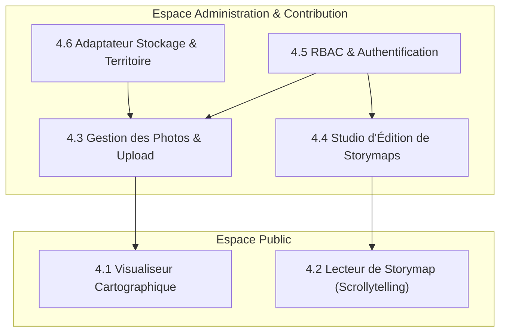

# PRD: HierIci
*Plateforme web cartographique et narrative de photographies historiques géolocalisées avec azimut de vue et storymaps.*

---

## 0. Document Purpose

Ce document définit les exigences fonctionnelles et non-fonctionnelles pour le développement de la version 1.0 (MVP) de **HierIci**. Il s'adresse à l'équipe de conception, à l'architecte système et aux développeurs. Il s'appuie directement sur le [Product Brief](file:///home/sylvain/projets/hierici/_bmad-output/planning-artifacts/briefs/brief-hierici-2026-10-30/brief.md) et l'[Addendum d'Analyse](file:///home/sylvain/projets/hierici/_bmad-output/planning-artifacts/briefs/brief-hierici-2026-10-30/addendum.md) finalisés en phase de cadrage.

Tous les termes métier utilisés dans ce document sont strictement définis dans le **Glossaire (§3)**. Les exigences fonctionnelles portent des identifiants stables et globaux (**FR-1** à **FR-N**) accompagnés de conséquences vérifiables et testables pour la recette.

---

## 1. Vision

**HierIci** transforme la manière dont le grand public et les passionnés de patrimoine explorent l'histoire de leurs territoires. Plutôt que de confiner les photographies anciennes dans des inventaires d'archives textuels ou de simples cartes aux marqueurs statiques, HierIci recrée la véritable perspective historique : **où se tenait le photographe et vers où regardait son objectif**.

Au-delà de l'exploration spatiale libre, HierIci apporte une dimension narrative inédite via son **moteur de Storymaps (scrollytelling)**. L'utilisateur est guidé dans un voyage spatio-temporel immersif où chaque étape synchronise le mouvement de la caméra cartographique, la photographie historique en grand format, l'analyse historique et des ambiances sonores ou témoignages audio d'époque.

Conçu sous licence libre **MIT**, modulaire et préparé dès son schéma de données pour le partitionnement par territoire, HierIci est à la fois un outil d'exploration immédiat pour son territoire pilote et un bien commun numérique réutilisable par toute collectivité ou collectif d'historiens.

---

## 2. Target User & Parcours

### 2.1 Jobs To Be Done (JTBD)

* **Visiteur curieux / Découvreur** :
  * *Fonctionnel* : Visualiser instantanément à quoi ressemblait une rue, un pont ou une usine à une époque donnée par rapport au plan actuel.
  * *Émotionnel* : Ressentir l'émotion de la redécouverte visuelle du passé de son cadre de vie quotidien.
  * *Narratif* : Suivre une histoire structurée (ex. l'essor ouvrier d'une ville) sans avoir à chercher soi-même des dizaines de notices disparates.
* **Contributeur / Géoréférenceur** :
  * *Fonctionnel* : Téléverser un cliché numérisé, positionner précisément le photographe, orienter son champ de vision (azimut/cône) et saisir les métadonnées d'archives en moins de 2 minutes.
  * *Social / Valorisation* : Rendre visible et utile au public un fonds d'archives ou une collection photographique dormante.
* **Curateur / Auteur de Storymap** :
  * *Fonctionnel* : Assembler des photos déjà géolocalisées en une séquence fluide de chapitres avec textes narratifs et pastilles audio.

### 2.2 Non-Users (v1)

* **Professionnels du SIG lourd (chercheurs géomatiques purs)** : HierIci ne cherche pas à concurrencer QGIS ou ArcGIS Pro ; il ne gère pas de calculs géodésiques complexes ni de recalage matriciel raster lourd.
* **Utilisateurs cherchant un réseau social généraliste** : Pas de fil d'actualité personnel, pas de système de "likes" ou de messagerie privée entre utilisateurs.

---

### 2.3 Key User Journeys (UJ)

#### UJ-1. Thomas explore son quartier au début du XXe siècle
* **Persona + contexte** : Thomas, 34 ans, habitant du centre-ville, curieux de savoir comment sa rue commerçante a évolué depuis 1900.
* **État d'entrée** : Non authentifié (visiteur public), sur smartphone ou desktop, arrive sur la page d'accueil de HierIci.
* **Cheminement** :
  1. Arrive sur la carte interactive centrée sur le territoire avec les marqueurs groupés (clusters).
  2. Tape le nom de sa rue ou zoome sur son quartier.
  3. Voit 3 marqueurs orientés. Clique sur un marqueur : le cône de vue s'illumine sur la carte et un tiroir/panneau s'ouvre avec la photo d'époque (1910).
  4. Ouvre la vue détaillée : lit la légende, la date, l'archive source (cote) et clique sur le zoom haute définition pour inspecter les devantures des boutiques d'autrefois.
* **Point culminant (Aha! Moment)** : Comprendre d'où la photo a été prise et repérer immédiatement le bâtiment encore debout à l'angle de sa rue.
* **Résolution** : Partage le lien direct de la photo à un proche ou poursuit son exploration sur les points voisins.

#### UJ-2. Sylvain (Contributeur/Admin) géolocalise une photo d'archive industrielle
* **Persona + contexte** : Sylvain, curateur du territoire, dispose d'un scan haute résolution d'une carte postale de 1925 montrant les anciens ateliers métallurgiques.
* **État d'entrée** : Authentifié avec le rôle Administrateur/Contributeur dans le panneau d'administration.
* **Cheminement** :
  1. Accède à l'interface d'administration `/admin/photos` et clique sur *Ajouter une photo*.
  2. Glisse-dépose le fichier image (`.jpg`). Une prévisualisation s'affiche instantanément.
  3. Remplit les métadonnées : Titre (*"Ateliers des Forges - Vue générale"*), Année (*1925*), Archive (*Archives Municipales, Cote 4Fi128*), Licence (*Domaine Public*).
  4. Sur la carte interactive intégrée au formulaire, clique à l'endroit exact où se trouvait l'opérateur (coordonnées GPS capturées).
  5. Fait pivoter le curseur d'orientation (boussole/poignée) vers le Sud-Est (azimut: 135°). Le cône visuel s'ajuste en temps réel.
  6. Choisit le statut *Publié* et clique sur *Enregistrer*.
* **Point culminant** : La photo apparaît immédiatement sur la carte publique avec son cône directionnel orienté à 135°.
* **Résolution** : La photo est indexée et disponible pour être sélectionnée dans une storymap.

#### UJ-3. Léa découvre la Storymap "Sur les pas des forgerons"
* **Persona + contexte** : Léa, 17 ans, lycéenne préparant un exposé sur l'histoire locale.
* **État d'entrée** : Non authentifiée, clique sur le lien d'une Storymap partagée sur les réseaux.
* **Cheminement** :
  1. Arrive sur le lecteur immersif de la storymap : titre accrocheur, carte en fond et premier volet narratif.
  2. Fait défiler la page vers le bas (*scroll*).
  3. La carte s'anime avec un mouvement fluide (*flyTo*) vers l'entrée de l'usine ; la photo d'époque de 1905 s'affiche en grand avec une citation d'ouvrier.
  4. Clique sur la pastille audio intégrée pour écouter 45 secondes de témoignage sonore d'archive.
  5. Continue de scroller : la carte pivote vers la cité ouvrière construite à 500m de là en 1920 avec la seconde photo.
* **Point culminant** : L'impression de faire une visite guidée vivante dans l'espace et le temps.
* **Résolution** : Arrive à la conclusion du récit avec les crédits d'archives et un bouton pour retourner à la carte générale du territoire.

---

## 3. Glossary

*Les termes ci-dessous font autorité pour le reste du PRD et l'implémentation. Aucun synonyme n'est toléré.*

* **Cliché / Photo** : Fichier image numérique historique associé à une notice descriptive et spatiale.
* **Prise de vue (Point d'ancrage)** : Coordonnées géographiques WGS84 (`latitude`, `longitude`) de l'emplacement physique où se tenait le photographe au moment du déclenchement.
* **Azimut (`bearing`)** : Angle horizontal en degrés (de 0° à 359°, 0° = Nord, 90° = Est) indiquant l'axe central vers lequel l'objectif de l'appareil était dirigé.
* **Cône de vue (`field_of_view`)** : Angle d'ouverture visuelle (ex. 60°) projeté sur la carte depuis le point d'ancrage le long de l'azimut, matérialisant la zone photographiée.
* **Storymap** : Récit thématique guidé composé d'une suite ordonnée d'Étapes (*scrollytelling*).
* **Étape (Chapitre de Storymap)** : Unité narrative d'une Storymap liant une vue cartographique (centre, zoom), un texte explicatif, une Photo mise en avant et éventuellement un fichier Audio.
* **Territoire** : Entité géographique et éditoriale autonome (ex. commune, communauté de communes, quartier) regroupant un corpus de Photos et de Storymaps.
* **Contributeur** : Utilisateur authentifié disposant du droit de téléverser des photos, d'éditer leur géoréférencement et de composer des storymaps.
* **Curateur / Admin** : Rôle d'administration ayant les droits de validation, de publication et de gestion des comptes.
* **Statut de publication** : État d'un enregistrement (Photo ou Storymap) : soit `draft` (visible uniquement en administration), soit `published` (accessible au grand public).

---

## 4. Features & Functional Requirements

---

### 4.1 Visualiseur Cartographique & Fiche Photo (Exploration Libre)
**Description** : Interface cartographique interactive plein écran permettant au public de découvrir les photos publiées d'un territoire. Les marqueurs affichent l'orientation de prise de vue. Au clic ou au survol, le cône de vue s'affiche et la fiche détaillée permet d'examiner le document historique. *Realizes UJ-1.*

#### FR-1 : Affichage cartographique et clustering
Le système doit afficher une carte interactive basée sur des fonds libres (OpenStreetMap / tuiles vectorielles) avec regroupement automatique des points (clustering) selon le niveau de zoom. *Realizes UJ-1.*
* **Conséquences testables** :
  * Lorsque plus de 2 photos sont proches à un niveau de zoom donné, un marqueur de cluster avec le décompte apparaît.
  * Au dézoom complet du territoire, tous les marqueurs sont visibles sans ralentissement cartographique (> 50 fps).
  * Seules les photos au statut `published` appartenant au territoire actif s'affichent pour les visiteurs non authentifiés.

#### FR-2 : Marqueur orienté et cône de vue
Le système doit afficher chaque photo sous forme d'un marqueur indiquant graphiquement son azimut, et projeter sur la carte un cône de vue polygonale lorsque le marqueur est sélectionné ou survolé. *Realizes UJ-1.*
* **Conséquences testables** :
  * Le marqueur d'une photo ayant un azimut de 90° pointe visuellement vers l'Est.
  * La sélection du marqueur affiche un cône d'ouverture paramétrée (défaut : 60°) orienté selon l'azimut sur une distance indicative de 100 à 300 mètres à l'échelle.
  * Une photo dont l'azimut est non renseigné s'affiche avec un marqueur circulaire neutre sans pointe directionnelle.

#### FR-3 : Fiche détaillée et métadonnées d'archives
Le système doit ouvrir un volet ou modal de détail au clic sur un marqueur, affichant la photo en grand format et toutes ses métadonnées documentées. *Realizes UJ-1.*
* **Conséquences testables** :
  * La fiche affiche : Titre, Photo optimisée pour l'écran, Date/Année, Auteur, Fonds d'archives, Cote/Inventaire, Licence et Lien externe source si disponible.
  * Un bouton permet d'afficher l'image originale en plein écran avec fonction de zoom (pan/zoom).
  * L'URL du navigateur se met à jour avec l'identifiant de la photo (ex: `?photo=42`), permettant le partage direct d'un cliché par lien profond.

---

### 4.2 Moteur de Storymaps (Scrollytelling & Narration)
**Description** : Lecteur immersif de récits spatio-temporels. Le visiteur fait défiler la page verticalement ; à chaque étape narrative, la carte se synchronise de manière fluide, la photo clé apparaît en grand format et un lecteur audio permet d'écouter les documents sonores associés. *Realizes UJ-3.*

#### FR-4 : Défilement scrollytelling et synchronisation caméra
Le système doit synchroniser la position de la caméra cartographique (centre, niveau de zoom) avec l'étape visible à l'écran lors du défilement vertical du lecteur de Storymap. *Realizes UJ-3.*
* **Conséquences testables** :
  * Le passage de l'étape N à l'étape N+1 déclenche une animation de transition cartographique fluide (`flyTo`) d'une durée comprise entre 1s et 2s.
  * L'étape courante met en surbrillance sur la carte le marqueur et le cône de vue de la photo associée.

#### FR-5 : Intégration multimédia (Textes riches & Audio)
Le système doit présenter pour chaque étape de la Storymap le titre, le texte formaté (markdown) et un lecteur audio compact si un fichier sonore est attaché à l'étape. *Realizes UJ-3.*
* **Conséquences testables** :
  * La lecture audio utilise la balise native HTML5 avec boutons lecture/pause et barre de progression.
  * Le lancement d'un audio à l'étape N met automatiquement en pause tout audio en cours d'une étape précédente.
  * Le texte narratif reste lisible et accessible sur écran mobile en superposition ou volet adapté sans masquer totalement la carte.

#### FR-6 : Catalogue des Storymaps publiques
Le système doit proposer une page ou un tiroir listant toutes les Storymaps publiées du territoire avec titre, vignette de couverture, description courte et durée estimée de lecture. *Realizes UJ-3.*
* **Conséquences testables** :
  * Seules les Storymaps ayant le statut `published` apparaissent dans le catalogue public.
  * Le clic sur une vignette ouvre le lecteur de Storymap en plein écran.

---

### 4.3 Studio d'Administration & Gestion des Médias (Upload, Métadonnées, Géolocalisation)
**Description** : Interface d'administration réservée aux utilisateurs authentifiés pour téléverser des photos, renseigner les métadonnées historiques et positionner graphiquement la prise de vue avec son azimut. *Realizes UJ-2.*

#### FR-7 : Téléversement de photos (Upload)
L'administrateur ou le contributeur doit pouvoir téléverser un ou plusieurs fichiers images (`.jpg`, `.jpeg`, `.png`, `.webp`) depuis son poste. *Realizes UJ-2.*
* **Conséquences testables** :
  * Le système accepte les images jusqu'à 25 Mo (limite validée pour permettre des scans haute définition d'archives tout en préservant les performances).
  * Lors de l'upload, le système génère automatiquement une version d'affichage web optimisée (WebP/JPEG compressé) et une vignette, tout en préservant l'original.
  * Un message d'erreur clair est renvoyé si le fichier dépasse la limite ou n'est pas une image valide.

#### FR-8 : Outil interactif de géoréférencement et azimut
L'interface de saisie d'une photo doit comporter une carte interactive permettant de définir le point de prise de vue et l'orientation de l'objectif par manipulation directe. *Realizes UJ-2.*
* **Conséquences testables** :
  * Un simple clic sur la carte positionne l'ancre du photographe et renseigne automatiquement les champs numériques `latitude` et `longitude` (précision 6 décimales).
  * Une poignée rotative ou un curseur angulaire (0-359°) permet d'ajuster l'azimut en voyant le cône pivoter en temps réel sur la carte.
  * Une saisie manuelle de l'azimut en degrés met immédiatement à jour l'orientation graphique du cône.

#### FR-9 : Saisie des métadonnées temporelles et documentaires
Le formulaire doit permettre de documenter avec précision le contexte archivistique et historique du cliché. *Realizes UJ-2.*
* **Conséquences testables** :
  * Champs obligatoires : Titre, Fichier image, Statut de publication (`draft` / `published`).
  * Champs optionnels : Date exacte ou Année de prise de vue (format numérique `YYYY` ou fourchette `YYYY-YYYY`), Période textuelle, Auteur/Photographe, Fonds d'archives, Cote/Numéro d'inventaire, URL de la notice source, Licence de réutilisation (menu déroulant avec choix par défaut : "Domaine Public", "Licence Ouverte", "Tous droits réservés / Avec autorisation").
  * Le système valide que les coordonnées GPS sont valides si le statut passe à `published` (une photo sans localisation ne peut pas être publiée sur la carte).

---

### 4.4 Studio d'Édition de Storymaps
**Description** : Outil d'administration permettant de concevoir un parcours narratif en agençant des étapes, en sélectionnant des photos de la base et en écrivant les textes. *Realizes UJ-3.*

#### FR-10 : Gestion et ordonnancement des chapitres de Storymap
L'auteur doit pouvoir créer une nouvelle Storymap, ajouter des étapes, modifier leur ordre par glisser-déposer (*drag and drop* ou boutons haut/bas) et définir les paramètres de chaque étape. *Realizes UJ-3.*
* **Conséquences testables** :
  * Chaque étape permet d'associer : une Photo issue de la base du territoire, un titre, un corps de texte en Markdown, un fichier audio optionnel (téléversé), et un réglage de cadrage cartographique (centre + zoom) capturé par un bouton *"Capturer la vue actuelle"*.
  * La réorganisation des étapes met immédiatement à jour les index d'ordre en base de données.
  * La Storymap peut être basculée entre `draft` et `published`.

---

### 4.5 Gestion des Utilisateurs & Rôles (RBAC)
**Description** : Système d'authentification et de contrôle d'accès garantissant la sécurité des données et des publications. *Realizes UJ-2.*

#### FR-11 : Authentification sécurisée
Le système doit permettre aux administrateurs et contributeurs de se connecter via un identifiant (email) et un mot de passe sécurisé. *Realizes UJ-2.*
* **Conséquences testables** :
  * Les mots de passe sont hachés avec un algorithme robuste (Argon2id ou bcrypt).
  * L'accès aux routes d'administration `/admin/*` et aux API d'écriture (`POST`, `PUT`, `DELETE`) exige un token d'authentification valide (session ou JWT).
  * Les tentatives répétées infructueuses de connexion sont limitées par un mécanisme de limitation de débit (*rate limiting*).

#### FR-12 : Contrôle d'accès basé sur les rôles (RBAC)
Le système doit faire respecter trois niveaux de privilèges : Superadmin, Contributeur, Visiteur (anonyme). *Realizes UJ-2.*
* **Conséquences testables** :
  * Un **Visiteur** ne peut exécuter que des requêtes de lecture (`GET`) sur les contenus `published`.
  * Un **Contributeur** peut créer/éditer des photos et des storymaps, mais ne peut pas modifier la configuration générale du système ni les autres utilisateurs.
  * Le **Superadmin** possède tous les droits d'administration, y compris la création de comptes et la gestion des territoires.

---

### 4.6 Gestion du Stockage Média & Architecture Multi-Territoire
**Description** : Socle d'infrastructure assurant le stockage pérenne des images/audios et l'isolation logique des données par territoire. *Realizes UJ-1, UJ-2.*

#### FR-13 : Adaptateur de stockage hybride (Local & S3)
Le système doit encapsuler l'écriture et la récupération des fichiers multimédias derrière une interface abstraite permettant le stockage sur disque local ou sur stockage objet S3 par configuration d'environnement. *Realizes UJ-2.*
* **Conséquences testables** :
  * Si `STORAGE_DRIVER=local`, les fichiers sont enregistrés dans le répertoire local configuré (volume persistant Docker).
  * Si `STORAGE_DRIVER=s3`, les fichiers sont transmis via l'API S3 standard vers le bucket spécifié (compatible MinIO, Cloudflare R2, AWS S3).
  * Le code applicatif de gestion des photos appelle la même méthode `storage.save()` sans dépendre de l'implémentation sous-jacente.

#### FR-14 : Partitionnement des données par territoire
Toutes les tables principales (photos, storymaps, contributeurs) doivent comporter une référence explicite `territoire_id` / slug. *Realizes UJ-1, UJ-2.*
* **Conséquences testables** :
  * Les requêtes de consultation publique filtrent systématiquement par le territoire actif.
  * Pour la V1, un territoire par défaut est configuré via une variable d'environnement (`DEFAULT_TERRITORY_SLUG`), rendant le système opérationnel immédiatement sur une URL unique tout en préparant la future navigation par sous-domaines (`{slug}.hierici.fr`).

---

## 5. Non-Goals (Ce que le produit n'est PAS en V1)

* **NON-GOAL 1 : Pas d'automatisation DNS / sous-domaines en libre-service** : Le MVP ne crée pas automatiquement de zones DNS. Les futurs sous-domaines seront gérés par configuration reverse proxy (Nginx/Traefik).
* **NON-GOAL 2 : Pas d'importation / moissonnage automatique par API d'archives** : Le système ne se connecte pas en V1 aux serveurs OAI-PMH de Gallica ou des ministères. L'alimentation se fait par upload manuel ou import fichier tabulaire ponctuel.
* **NON-GOAL 3 : Pas de calcul 3D automatique ni de recalage par IA** : La pose du marqueur et de l'azimut reste un acte humain délibéré assisté par une interface visuelle simple.
* **NON-GOAL 4 : Pas de réseau social ni de commentaires non modérés** : Aucun système de forum ou de commentaires libres pour éviter les problématiques de spam et de modération juridique en V1.

---

## 6. MVP Scope

### 6.1 In Scope (Livrables MVP V1)
1. Carte publique interactive avec tuiles libres et regroupement (clustering).
2. Marqueurs directionnels affichant l'azimut et cône de vue projeté.
3. Fiche détaillée de la photo avec métadonnées d'archives et visionneuse plein écran.
4. Lecteur de Storymap en scrollytelling synchronisé avec la carte, texte et lecture audio.
5. Interface d'administration sécurisée par mot de passe.
6. Formulaire d'upload de photo avec outil de géoréférencement interactif (carte + boussole d'azimut).
7. Éditeur de Storymap (création d'étapes, association de photos, rédaction texte, import audio, capture de cadrage).
8. Workflow de publication (`draft` / `published`).
9. Modèle de données partitionné par `territoire_id`.
10. Adaptateur de stockage hybride (Local par défaut / S3 prêt).
11. Licence open source MIT.

### 6.2 Out of Scope (Reporté à la V2 / V3)
* Mode "Rephotographie" smartphone in-situ (comparaison avant/après en transparence avec appareil photo). *(Prévu V2)*
* Superposition de couches cartographiques historiques (cadastre napoléonien, photos aériennes 1950) avec curseur de transparence. *(Prévu V2)*
* Formulaire public de "Suggestion de correction / proposition de photo" sans compte. *(Prévu V2)*
* Provisioning automatisé de sous-domaines multi-tenants en self-service. *(Prévu V3)*

---

## 7. Cross-Cutting NFRs (Exigences Non-Fonctionnelles)

* **Performance & Fluidité (NFR-1)** :
  * Temps de chargement initial de la carte < 1.5 seconde sur connexion 4G standard.
  * Transitions cartographiques (*flyTo*) fluides à 60 fps sur navigateurs modernes (Chrome, Firefox, Safari desktop et mobile).
* **Sécurité & Intégrité (NFR-2)** :
  * Hachage des mots de passe en Argon2id ou bcrypt avec sel individuel.
  * Validation stricte des types MIME et désinfection des fichiers uploadés (suppression d'éventuels scripts embarqués dans les images).
  * Protection contre les injections SQL (requêtes préparées / ORM) et failles XSS sur les textes Markdown des storymaps.
* **Responsive Design (NFR-3)** :
  * L'application web doit être utilisable à 100 % sur écran mobile (smartphones ≥ 360px de largeur) et ordinateurs de bureau.
* **Licence & Droits (NFR-4)** :
  * Code source sous licence MIT.
  * Préservation obligatoire des mentions de crédits et de licences sur chaque cliché affiché.

---

## 8. Success Metrics (Critères de Succès)

* **SM-1 (Richesse du corpus pilote)** : Au moins 50 photos d'archives géolocalisées avec azimut renseigné et publiées sur le territoire pilote. *Validates FR-1, FR-2, FR-8, FR-9.*
* **SM-2 (Storymaps publiées)** : Au moins 2 storymaps narratives complètes créées et lisibles sans bug par le public. *Validates FR-4, FR-5, FR-6, FR-10.*
* **SM-3 (Facilité de contribution)** : Temps moyen pour téléverser et géolocaliser une photo inférieur à 2 minutes pour un utilisateur habitué. *Validates FR-7, FR-8.*
* **SM-C1 (Contre-métrique de qualité / Précision vs Quantité)** : Ne pas chercher à maximiser le nombre brut de photos si la précision de localisation ou l'azimut est incertain. Une photo approximative doit rester en brouillon (`draft`) tant que son ancrage n'est pas vérifié.

---

## 9. Assumptions Index (Index des Hypothèses)

*Toutes les hypothèses initiales ont été formellement validées :*
* **§4.3 FR-7 (Validée)** : Limite maximale de taille de fichier fixée à 25 Mo par photo pour permettre des scans haute définition sans saturer la mémoire serveur lors du redimensionnement.
* **§4.6 FR-14 (Validée)** : Utilisation d'une variable d'environnement `DEFAULT_TERRITORY_SLUG` pour faire fonctionner l'instance V1 sur une URL unique tout en garantissant que toutes les requêtes sont déjà cloisonnées par territoire en base de données.
